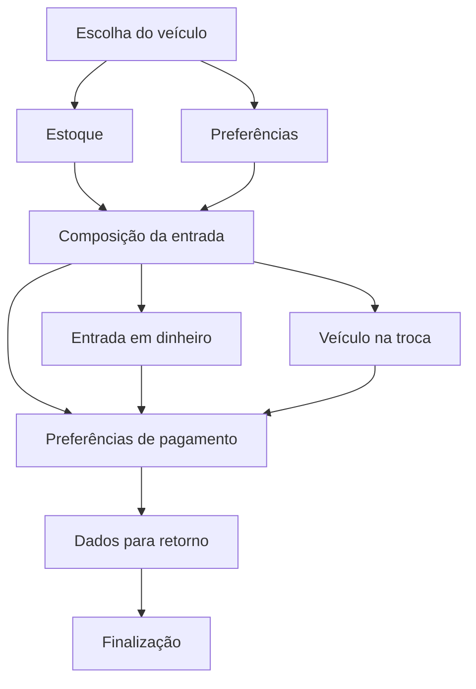

# Percursos da Garage 88

A atualização mantém IDs, títulos, ordem, ícones, visibilidade e ações diretas existentes. Altera os quatro percursos guiados no rascunho local. A gaveta da equipe e o link para o estoque completo continuam como ações diretas.

## Financiamento

O visitante escolhe um veículo do estoque ou informa suas preferências. Em seguida, escolhe entre entrada em dinheiro, veículo na troca ou consulta sem entrada. Cada alternativa pede somente os dados correspondentes. Os caminhos se reúnem nas preferências de prazo e nos dados para retorno.

Não calcula juros ou aprovação bancária. Os valores informados representam preferências do visitante. A conclusão informa que taxa, prazo e aprovação dependem da análise da instituição financeira.

## Seguro

Seguro novo segue para o uso do veículo; renovação pede informações opcionais da apólice atual antes de reunir os caminhos. Uso profissional abre perguntas sobre a atividade; uso particular segue diretamente aos dados do veículo. Todos terminam nos dados para retorno.

## Venda e troca

A escolha inicial separa venda, troca e troca com interesse em receber a diferença. Os caminhos de troca perguntam pelo próximo veículo. A venda segue diretamente aos dados do veículo usado. Todos registram dados para retorno; a avaliação não é prometida como concluída e nenhum prazo automático de atendimento é anunciado.

## Showroom

Depois de selecionar um produto do estoque, o visitante escolhe entre consultar disponibilidade/proposta e combinar uma visita ou test-drive. Somente a segunda opção pergunta pela preferência de agenda. A preferência não confirma um agendamento. O percurso deixa de oferecer quantidade de veículos ou total comercial multiplicado.

## Conclusões e edição

Os quatro percursos mostram resumo ordenado sem dados pessoais de contato, com WhatsApp como continuação principal e estoque completo como ação secundária. A mensagem de WhatsApp autoriza os mesmos dados não pessoais do resumo, respeitando o caminho efetivamente percorrido. O registro é confirmado pelo backend antes da conclusão.

No editor, **Destino da opção** permite escolher a próxima etapa de cada resposta de escolha única. O diagrama distribui os ramos em colunas e os reúne visualmente quando convergem. A validação de ciclos e etapas inalcançáveis continua ativa.

## Aplicação local

- `npm run atualizar:microfluxos-garage88 -- --validar` revisa o estado atual sem gravar.
- `npm run atualizar:microfluxos-garage88` atualiza os rascunhos com backup dos documentos anteriores em `/tmp/garage88-backups/`.
- `npm run emuladores:salvar` preserva o estado local entre reinicializações.

O script exige o emulador `demo-fluxo`, resolve o tenant pelo identificador público e confere a organização esperada. A gravação é transacional e recusa alterações concorrentes. Conclusões já personalizadas são preservadas quando suas referências continuam válidas; referências a campos removidos interrompem a atualização para revisão. Os dados de recuperação também adotam os novos modelos quando a organização é criada em um emulador vazio.

A vitrine pública e suas versões não são alteradas pelo script. A publicação permanece disponível pelo botão **Publicar alterações** do painel.

Validação: 363 testes passaram; tipos da aplicação e das funções aprovados, assim como lint dos arquivos alterados.

Os quatro rascunhos também foram convertidos para [composição livre](etapas-livres.md), mantendo seus percursos. Para converter um estado local existente sem recarregar os modelos, use `npm run atualizar:microfluxos-garage88 -- --composicao-livre`. Os passos de contato agora são conjuntos de campos com finalidade de retorno, editáveis e ordenáveis como os demais elementos.
